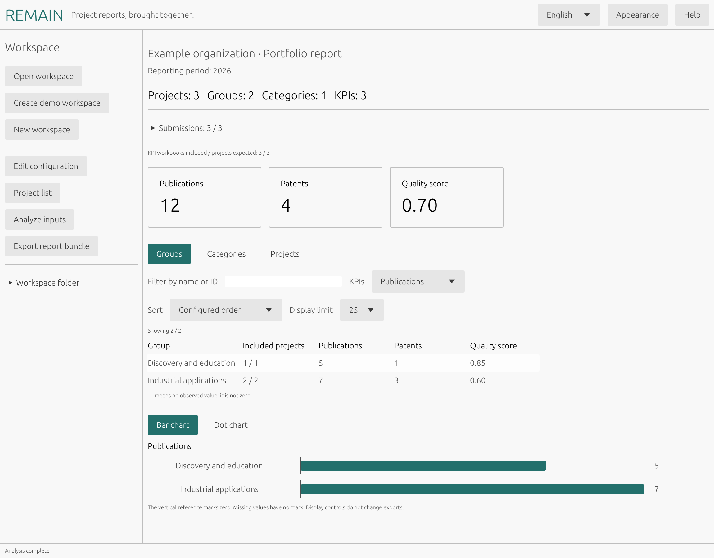

# REMAIN

REMAIN is a desktop application for managing and integrating different (sub)project reports
with optional groups and categories. It allows analyzing and exporting assembled report documents,
key performance indicators (KPIs) submitted via Excel files, and printable HTML summaries.

KPIs can include class breakdowns from a property column, such as publications
by conference or journal type.

  

  <strong><a href="https://hougui.github.io/remain/">User guide</a> · <a href="https://hougui.github.io/remain/api/">Rust API reference</a></strong>

REMAIN was originally developed at the [InnovationCampus Future Mobility (ICM)](https://www.icm-bw.de/en/).
This open-source version is an independent more-general reimplementation written entirely from scratch.

## Start Here

- [Install REMAIN](docs/installation.md)
- [Tutorials](docs/tutorials.md)
- [Prepare inputs](docs/workspaces.md) and [configure indicators](docs/configuration.md)
- [Understand exports](docs/outputs.md) and [troubleshoot](docs/troubleshooting.md)
- For developers:
    - [Build, test, and contribute](docs/development.md)
    - [Package and deploy releases](docs/deployment.md)

## Repository Layout

- `assets/fonts/`: bundled fonts and their licenses
- `crates/`: Rust workspace
    - `remain-core/`: reporting, validation, and analysis
    - `remain-app/`: native desktop GUI
- `docs/`: documentation
- `examples/`: synthetic workspaces
- `locales/`: translations for the interface and generated report labels
- Distribution tooling
    - `packaging/`: installers and platform assets
    - `scripts/`: build, documentation, and packaging commands

Released under the [MIT license](LICENSE).
